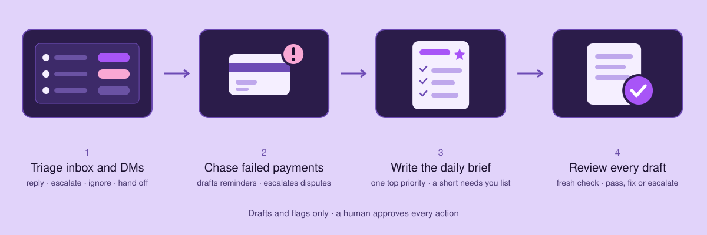

# E-Assistant



An executive assistant agent for a creator-business founder, built as a Claude Code project. It triages the inbox and DMs, drafts replies in the founder's voice, chases failed payments and writes a short daily priorities brief. It drafts and flags. A human approves every action.

The founder (Jordan Lee), the ops manager (Sam) and all data are fictional. It is meant as a starting point for any solo founder or creator: swap the example context files for your own voice, rules and details, and the same skills work for your business.

## How it works

Run `/e-assistant` and it runs this chain:

1. **Inbox triage** - Sorts every email and DM into reply, escalate, ignore or hand-off, and drafts replies for the safe ones
2. **Payment chase** - Finds failed payments and open disputes, drafts reminders, escalates the rest to ops
3. **Daily priorities** - Writes a one-page brief with a single top priority and a "needs you" list capped at five
4. **Review drafts** - A separate pass that checks every draft against the voice guide and escalation rules

## Setup

You need [Claude Code](https://docs.claude.com/en/docs/claude-code/overview) and Python 3. There are no dependencies beyond the standard library.

```bash
git clone <this repo>
cd exec-assistant
claude
```

Then run `/e-assistant`. Run `claude` from the repo root so it picks up the skills and `AGENTS.md`.

Check the helpers:

```bash
cd helpers && python3 -m unittest test_checks -v
```

## How the agent is put together

There is no framework and no program controlling the model. The agent is a Claude Code project:

- **`AGENTS.md`** holds the routing table and the hard rules (drafts only, escalate when unsure).
- **An orchestrator skill,** `.claude/skills/e-assistant/SKILL.md`, runs the chain in order or routes a single request to one skill.
- **One skill per job,** each usable alone.
- **A `context/` folder** with the voice guide, the escalation rules, the founder's preferences, and `corrections.md`, which the agent reads before every run and adds to when you correct a draft.
- **A helper,** `helpers/checks.py`, so date maths, calendar clashes and payment rules run in code and not in the model's head.
- **One dated folder per run** under `outputs/`, so anyone can see what was triaged, drafted and reviewed.

## Project structure

```
exec-assistant/
├── AGENTS.md
├── context/               # voice, escalation rules, principal, corrections
├── data/                  # synthetic inbox, DMs, calendar, payments
├── docs/workflow.svg      # diagram at the top of this README
├── helpers/               # checks.py and its tests
├── evals/scenarios.md     # three test scenarios per skill
├── outputs/               # one folder per run (not tracked)
└── .claude/skills/        # e-assistant, inbox-triage, payment-chase, daily-priorities, review-drafts
```

## Safety design

- Nothing is sent, booked, refunded or filed. Every output is a draft or a flag.
- Escalation rules decide what is safe to draft. Anything about money, brands, press, distress, legal or access goes to a named person.
- A second pass reviews drafts with fresh context and never edits them.
- Payment and personal details are limited to first names, ids and amounts.
- Real details live in `context/*.private.md` and `data/private/`, both git-ignored.

## Not in this version

- Expense receipt collection, podcast guest coordination, newsletter scheduling and calendar changes are planned for a later version.
- Booking travel and handling rental or guest communications stay human by design.
- The skills run on mock data. Real Gmail, Calendar, Instagram and Stripe connectors are not wired up yet.

## Make it yours

1. Replace `context/voice.md` with your own tone rules and three to five real replies.
2. Edit `context/escalation.md` so the "always escalate" list matches what you never want handled without you.
3. Fill in `context/principal.md` with your facts, hours, prices and VIPs.
4. Keep real details in `context/*.private.md` and `data/private/` so they stay out of git.
5. Swap the files in `data/` for your own exports, or connect real tools later.

## Open questions

- Which messages count as "sensitive" varies by founder. The escalation list is a starting point and should be tuned after real use.
- Voice quality depends on how many real examples go into `voice.md`. Three is enough to start; more is better.
- The stale-reply threshold (2 days) and the failed-payment limits (3 attempts, 7 days) are judgment calls, set as named constants in `helpers/checks.py`.
